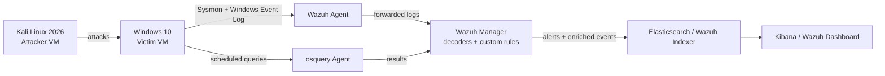

# Architecture

## Logical Diagram

## Network Segmentation

All three VMs sit on an isolated internal/host-only network (`192.168.56.0/24`) so that offensive traffic (brute force, exploit attempts) never touches the physical home network. See [`00-lab-topology.md`](00-lab-topology.md) for exact IP assignments and VM specs.

## Design Principles

1. **Every piece of telemetry maps to a documented detection.** Nothing is collected "just in case" — Sysmon filtering and osquery's schedule are both intentionally scoped (see `configs/`).
2. **Every attack has a matching write-up.** No simulation is run without a corresponding entry in `attack-simulations/mitre-mapped/`.
3. **Evidence over description.** Screenshots exist for every major claim in this README — an interviewer should be able to verify the lab actually ran, not just take the markdown's word for it.
